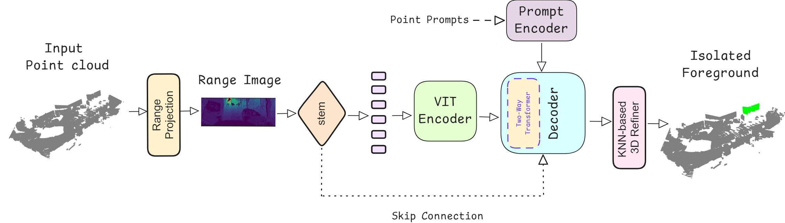
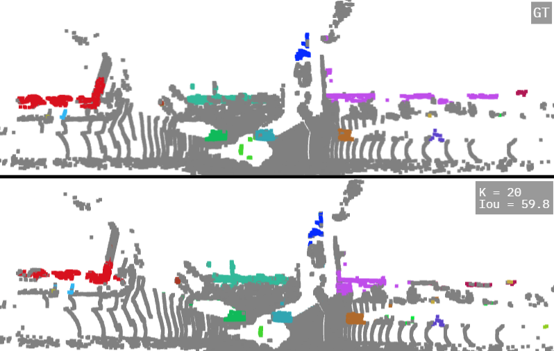

# RangeSAM: Promptable Segmentation of Sparse 3D Point Clouds

[](https://doi.org/10.5281/zenodo.18012998)



RangeSAM is a novel architecture designed for 3D promptable point cloud segmentation, specifically tailored to address the challenges of sparse LiDAR data in outdoor driving scenes. By integrating range-based processing techniques with transformer architectures from state-of-the-art 2D promptable segmentation models, RangeSAM effectively handles sparse and irregular LiDAR data while maintaining high segmentation fidelity.

The thesis is available in [`research/Thesis.pdf`](research/Thesis.pdf) and on [Zenodo](https://zenodo.org/records/18012998).

## Overview

Given a LiDAR scan and a few point prompts (foreground and background clicks), RangeSAM segments the indicated object.
It builds on the range-image backbone of [RangeViT](https://github.com/valeoai/rangevit) and the promptable design of
[Segment Anything (SAM)](https://github.com/facebookresearch/segment-anything):

1. **Instance selection and range projection.** The scan is projected to a 64 × 2048 range image with five channels (range, x, y, z, intensity). The image is then cropped to 64 × 384 around the object of interest.
2. **Image encoder.** A convolutional stem and a ViT-S/16 encoder, initialised from Cityscapes-pretrained weights.
3. **Prompt encoder.** Random Fourier positional encodings plus learned foreground and background embeddings.
4. **Decoder.** An up-convolution decoder with a bi-directional (two-way) prompt–image transformer, a learnable scaling factor on the image features, and *prompt label enforcement* at the clicked pixels.
5. **KNN 3D refinement.** Maps the 2D mask back onto every 3D point.

The model is trained on [KITTI-360](https://www.cvlibs.net/datasets/kitti-360/) with a focal + dice + *prompt* loss. It is
evaluated on KITTI-360, [SemanticKITTI](http://www.semantic-kitti.org/) and [ApolloScape](https://apolloscape.auto/tracking.html).

## Results

Main model trained on KITTI-360 (IoU in %):

| Evaluation | Metric | Result |
|---|---|---|
| KITTI-360 test | IoU@20 | 56.05 |
| SemanticKITTI (unseen) | IoU@20 | 56.3 |
| ApolloScape (unseen) | IoU@20 | 46.1 |
| SemanticKITTI, K = 20 | Precision / Recall / F1 | 79.7 / 70.5 / 74.4 |
| SemanticKITTI, K = 20 | AP@25 / AP@50 / AP / S<sub>assoc</sub> | 57.2 / 53.6 / 73.3 / 50.4 |



*A complete KITTI-360 scan: ground truth (top) and RangeSAM's prediction (bottom). Each instance is segmented with K = 20 clicks; the mean IoU over the scan is 59.8.*

## Repository structure

```
configs/              training / evaluation configs (KITTI-360, SemanticKITTI, ApolloScape)
dataset/              dataset readers, range projection, augmentation and instance cropping
models/               RangeSAM: ViT encoder, conv stem, prompt encoder, two-way transformer, decoder
utils/                losses, LR schedule, metrics, prompt sampling, KNN refiner, logging
scripts/data_prep/    per-instance mask generation for the three datasets
third_party/          KITTI-360 per-scan label recovery
main.py, train.py     training
evaluate.py           evaluation with simulated clicks
images/               figures used in this README
research/             thesis and research proposal
```

## Installation

Requires Python 3.10–3.12 (PyTorch 2.3):

```bash
git clone https://github.com/arya-araban/rangeSAM.git
cd rangeSAM
pip install -r requirements.txt
```

Download the Cityscapes pre-trained ViT encoder weights (`checkpoint.pth`) from
[here](https://www.rocq.inria.fr/cluster-willow/rstrudel/segmenter/checkpoints/cityscapes/seg_small_linear/).
These are the [Segmenter](https://github.com/rstrudel/segmenter) ViT-S/16 weights. They initialise the encoder through
`--pretrained_model` and are only needed for training.

## Datasets

| Dataset | Role | Files to download |
|---|---|---|
| [KITTI-360](https://www.cvlibs.net/datasets/kitti-360/download.php) | Training and main evaluation | `data_3d_raw` (Velodyne scans), `data_3d_semantics`, `data_poses`, `calibration` |
| [SemanticKITTI](http://www.semantic-kitti.org/dataset.html#download) | Cross-dataset evaluation | [KITTI odometry Velodyne scans](https://www.cvlibs.net/datasets/kitti/eval_odometry.php) + SemanticKITTI labels |
| [ApolloScape](https://apolloscape.auto/tracking.html) | Cross-dataset evaluation | 3D LiDAR object detection: `detection_train_bin`, `detection_train_label` |

RangeSAM is trained on (scan, instance) pairs. For every scan, each object instance is stored as a sparse binary mask
over the scan's points. The scripts below generate these masks from the official labels:

```
<scan_dir>/<frame>.bin
<label_dir>/<frame>/<class>_<n>.npz      # one mask per instance
```

### KITTI-360

KITTI-360 annotates accumulated point clouds, not the individual raw scans. The labels of each raw scan are recovered first with
[`third_party/recoverKITTI360label`](third_party/recoverKITTI360label). It is
[recoverKITTI360label](https://github.com/MarcusSchilling/recoverKITTI360label) by MarcusSchilling, a Python re-implementation of
[accumuLaser](https://github.com/autonomousvision/kitti360Scripts/tree/master/kitti360scripts/devkits/accumuLaser)
from the KITTI-360 devkit. It needs `open3d` and `opencv-python`:

```bash
cd third_party/recoverKITTI360label
python recoverLabels.py --kitti_dir <KITTI-360> --output_dir <KITTI-360-labels>
cd ../..
python scripts/data_prep/kitti360_instances.py --raw_root <KITTI-360>/data_3d_raw --labels_root <KITTI-360-labels>
```

This writes `instance_labels/` next to `velodyne_points/` in every `data_3d_raw/2013_05_28_drive_XXXX_sync` folder.
It covers the 21 KITTI-360 instance classes over 64,640 labelled scans. The split in `configs/kitti360.yaml` uses
sequences 0, 2, 4, 5, 6, 7 and 10 for training, 3 for validation and 9 for testing.

### SemanticKITTI

```bash
python scripts/data_prep/semantic_kitti_instances.py --root <SemanticKITTI>/dataset/sequences
```

### ApolloScape

Instances are the points inside each annotated 3D box:

```bash
python scripts/data_prep/apolloscape_instances.py --root <ApolloScape>
```

## Training

```bash
python main.py configs/kitti360.yaml \
    --data_root <KITTI-360>/data_3d_raw \
    --save_path <log_dir> \
    --pretrained_model <path>/checkpoint.pth
```

- **Multiple GPUs:** `torchrun --nproc_per_node=<N> main.py ...`
- **Resume:** `--checkpoint <log_dir>/log_kitti360/checkpoint/checkpoint.pth`
- **Validation only:** `--val_only --checkpoint <ckpt>`; add `--test_split` to use the test split.

`configs/kitti360.yaml` holds the full training setup:
- 200 epochs, batch size 8
- AdamW with weight decay 0.01, peak learning rate 4e-4, 10 warm-up epochs and cosine decay
- loss weights 20 / 1 / 0.3 for focal / dice / prompt loss
- 1–12 foreground and 0–8 background clicks per training example
- point cloud augmentation

`configs/semantic_kitti.yaml` trains the same model on SemanticKITTI.

**Ablations.** Each of RangeSAM's three components can be switched off in the config:

```yaml
use_prompt_loss: true         # prompt loss
label_enforcement: true       # prompt label enforcement
learnable_prompt_scale: true  # learnable scaling factor in the two-way transformer
```

## Evaluation

`evaluate.py` segments every object instance in the evaluated scans with K simulated clicks:
- About 65% of the clicks are foreground and 35% background.
- Background clicks are taken from the instance's bounding box enlarged by 20%.
- K = 1 uses a single foreground click; every K > 1 includes at least one background click.

Each prediction is refined in 3D and scored with IoU@K (3D IoU after K clicks). The output reports IoU@K averaged over
classes and over instances, plus a per-class table.

```bash
# IoU@K on the KITTI-360 test split
python evaluate.py configs/kitti360.yaml --data_root <KITTI-360>/data_3d_raw --checkpoint <ckpt> --k 1 3 5 10 20

# Foreground-only, background-only and inverted clicks
python evaluate.py configs/kitti360.yaml ... --prompts fg_only     # or bg_only / inverted

# 'Dense' objects only (centre within 15 m and at least 50 points)
python evaluate.py configs/kitti360.yaml ... --dense --k 1 3 5 7 10

# Cross-dataset evaluation of the KITTI-360 model
python evaluate.py configs/apolloscape.yaml --data_root <ApolloScape> --checkpoint <ckpt> \
    --model_config configs/kitti360.yaml --k 5 10 15 20
python evaluate.py configs/semantic_kitti.yaml --data_root <SemanticKITTI>/dataset/sequences --checkpoint <ckpt> \
    --model_config configs/kitti360.yaml --sequences 8 9 10 --k 5 10 15 20

# Precision, recall, F1, AP@25, AP@50, AP and S_assoc at K = 20
python evaluate.py configs/semantic_kitti.yaml ... --model_config configs/kitti360.yaml --k 20 --all_metrics
```

Options:
- `config`: the dataset and range projection to evaluate on.
- `--model_config`: the config the checkpoint was trained with. Defaults to `config`.
- `--num_scans N`: evaluate a random subset of scans.
- `--seed`: fixes the scan subset and the clicks. The same seed gives the same clicks for every model.
- `--output results.json`: save all numbers.

## Acknowledgements

This code builds on the following works:

- [RangeViT](https://github.com/valeoai/rangevit) (Ando et al., CVPR 2023): range-image backbone, convolutional stem, decoder and training pipeline
- [Segment Anything](https://github.com/facebookresearch/segment-anything) (Kirillov et al., ICCV 2023): prompt encoder and two-way transformer
- [Segmenter](https://github.com/rstrudel/segmenter) (Strudel et al., ICCV 2021): ViT implementation and Cityscapes pre-trained weights
- [timm](https://github.com/huggingface/pytorch-image-models): ViT blocks
- [lidar-bonnetal](https://github.com/PRBonn/lidar-bonnetal) and [SalsaNext](https://github.com/TiagoCortinhal/SalsaNext): KNN post-processing, IoU evaluator and learning-rate schedule
- [PMF](https://github.com/ICEORY/PMF): point cloud augmentation and metric logging
- [recoverKITTI360label](https://github.com/MarcusSchilling/recoverKITTI360label) by MarcusSchilling (a fork of [JulesSanchez/recoverKITTI360label](https://github.com/JulesSanchez/recoverKITTI360label)): KITTI-360 label recovery, included unmodified in `third_party/`

## Citation

If you use this work, please cite:

> Araban, A. (2025). *RangeSAM: Promptable Segmentation of Sparse 3D Point Clouds in Outdoor Driving Scenes*. Zenodo. https://doi.org/10.5281/zenodo.18012998

```bibtex
@misc{araban2025rangesam,
  author    = {Araban, Arya},
  title     = {RangeSAM: Promptable Segmentation of Sparse 3D Point Clouds in Outdoor Driving Scenes},
  year      = {2025},
  publisher = {Zenodo},
  doi       = {10.5281/zenodo.18012998},
  url       = {https://doi.org/10.5281/zenodo.18012998}
}
```

## License

- **Source code:** released under the [Apache License 2.0](LICENSE), the license of RangeViT, on which it builds.
- **Thesis, figures and documentation** (`research/`, `images/`, this README): licensed under [CC BY-NC-ND 4.0](research/LICENSE).
- **Third-party code:** keeps its original license.
- **Datasets:** KITTI-360, SemanticKITTI and ApolloScape are subject to their own terms of use.
